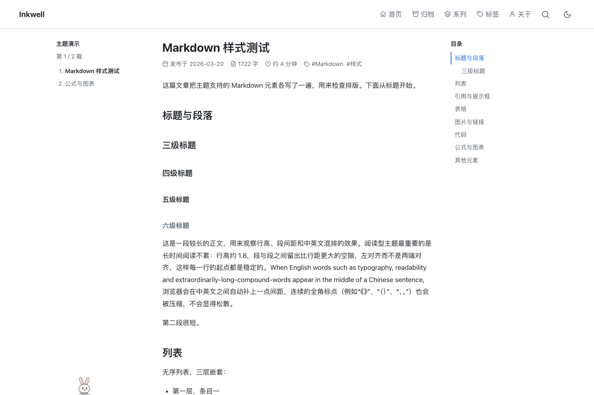
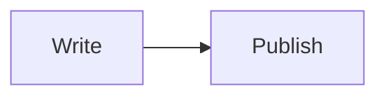

# Inkwell

English | [简体中文](https://github.com/boreasward/Inkwell/blob/main/README.zh-CN.md)

Inkwell is a reading-first Hugo theme. It has a clean white look and a reading experience designed for both narrow (phone) and wide (desktop) screens. Long-form text (with special care for Chinese), code, images, math and diagrams all have consistent styles, in both light and dark color schemes.



Highlights:

- Three article layouts by width: on wide screens a scroll-spy table of contents sits to the right of the text and series navigation to the left (at medium widths the series panel moves into a bottom drawer); on narrow screens a floating button opens a drawer with TOC and series tabs.
- Tuned typography, especially for Chinese: line height, paragraph spacing, measure, mixed CJK/Latin text and punctuation compression. Overly wide code, tables, images, formulas and long links are contained in their own blocks and never cause horizontal page scrolling.
- Code blocks (syntax highlighting, language label, copy button, line numbers and highlighted lines), callouts, image captions with click-to-zoom, math formulas and Mermaid diagrams.
- Series (based on a Hugo taxonomy), tags, archives, client-side search, dark mode (follows the system by default, can be toggled) and giscus comments (off by default).
- Small touches: line icons on navigation, dates and footer links, plus a little bunny that hops along the bottom of the page (can be turned off).
- Just the `hugo` command: no Node, no bundler, no Hugo extended, system fonts only. The only third-party libraries are the KaTeX stylesheet, Mermaid and giscus, all loaded from a CDN on demand, with configurable URLs.

## Requirements

- Hugo **≥ 0.158.0** (the theme uses the `locale` setting and `.Site.Language.Locale`). The extended edition is not required.
- Developed and tested with Hugo 0.169.0.

## Installation

Put the theme into `themes/Inkwell` in your site directory, using either method:

```bash
# Option 1: git submodule
git submodule add https://github.com/boreasward/Inkwell.git themes/Inkwell

# Option 2: plain clone
git clone https://github.com/boreasward/Inkwell.git themes/Inkwell
```

Then set `theme = "Inkwell"` in your site configuration and copy the site configuration from the next section.

Alternatively, use it as a Hugo Module (requires Go): run `hugo mod init github.com/<you>/<your-site>` in your site, then replace `theme = "Inkwell"` with:

```toml
[module]
  [[module.imports]]
    path = "github.com/boreasward/Inkwell"
```

## Required site configuration

Hugo only merges `params`, menus, output formats and media types from a theme's configuration. It does **not** merge `taxonomies`, `markup`, language settings and so on, so the following must be declared by your site. Copy the whole block into your `hugo.toml`:

```toml
# Chinese site; for an English site use locale = "en-US",
# defaultContentLanguage = "en" and hasCJKLanguage = false
locale = "zh-CN"
defaultContentLanguage = "zh-cn"
hasCJKLanguage = true
theme = "Inkwell"

[pagination]
  pagerSize = 20

[taxonomies]
  tag = "tags"
  series = "series"

[markup.tableOfContents]
  startLevel = 2
  endLevel = 3
[markup.goldmark.extensions.passthrough]
  enable = true
  [markup.goldmark.extensions.passthrough.delimiters]
    block = [['\[', '\]'], ['$$', '$$']]
    inline = [['\(', '\)']]
[markup.goldmark.parser]
  wrapStandAloneImageWithinParagraph = false
[markup.goldmark.renderer]
  unsafe = true
```

When a setting is missing Hugo does **not** report an error; the related feature just quietly disappears. Each setting explained:

| Setting | Purpose | If missing |
|---|---|---|
| `locale` | Written to `<html lang>` and decides the giscus widget language | `<html lang>` falls back to the content language name (e.g. `zh-cn`, or `en` when `defaultContentLanguage` is unset) instead of a standard tag like `zh-CN`; giscus matches its language by that name, which usually still works |
| `defaultContentLanguage` | Selects the UI text language (the theme ships `zh-cn` and `en`) | UI text such as the TOC, previous/next, search and callout labels is in English |
| `hasCJKLanguage = true` | Counts Chinese words by character | Word count, reading time and automatic summaries are far too small (a whole Chinese paragraph counts as one "word"). Set it to `false` or omit it for an English-only site |
| `theme = "Inkwell"` | Enables the theme; must match the directory name under `themes/` | The site has no templates at all |
| `[pagination] pagerSize` | Posts per page on the home list | Hugo's default of 10 (the example site uses 5 to demonstrate pagination; 20 is recommended for real sites) |
| `series` in `[taxonomies]` | Declares the "series" taxonomy | All series features vanish: series pages, the series tab and numbering in articles, previous/next within a series and the series overview; `series` becomes plain front matter. Keep `tag = "tags"` too, or tags disappear as well |
| `[markup.tableOfContents]` | Heading levels in the TOC (2 to 3) | Hugo's default, which happens to be 2 to 3 as well; it is spelled out to make the levels explicit, and changing it changes the TOC |
| `passthrough` and `delimiters` | Lets `\( \)`, `\[ \]` and `$$ $$` be recognized as math | Formulas stay as raw LaTeX: not typeset, and the KaTeX stylesheet is not loaded |
| `wrapStandAloneImageWithinParagraph = false` | A standalone image renders as a `<figure>` | Images fall back to inline `` with no caption (`title` is only a hover tooltip) and no figure styles |
| `[markup.goldmark.renderer] unsafe = true` (optional) | Allows raw `<kbd>`, `<mark>` and `<details>` in content | Raw HTML is dropped (rendered as `<!-- raw HTML omitted -->`) and Hugo prints a warning; not needed if you don't use these tags |

The example site (`exampleSite/hugo.toml`) additionally sets `themesDir = "../.."`, `[params.search] enable = true` and `menus.main`. Navigation uses Hugo's standard `menus.main`:

```toml
[[menus.main]]
  name = "Archives"
  pageRef = "/archives"
  weight = 20
```

The archives page needs a content file `content/archives.md` with front matter `layout = "archives"` (optionally `title = "Archives"`). The series overview lives at `/series/` and the tag overview at `/tags/`; Hugo generates both automatically.

## Theme configuration (params)

These are all the `params` in the theme's `hugo.toml`, with their defaults. Set a key with the same name in your site configuration to override it.

```toml
[params.home]
  listStyle = "compact"
[params.article]
  showWordCount = true
  showReadingTime = true
  externalLinkNewTab = true
[params.search]
  enable = false
[params.math]
  enable = true
  css = "https://cdn.jsdelivr.net/npm/katex@0.18.4/dist/katex.min.css"
  cssIntegrity = "sha384-u1zONI5gPXUx0UKI62c75/zww972y0v2rSK5ZYlVdS6xEuWDeZWUI66v6t1gvlXJ"
[params.mermaid]
  url = "https://cdn.jsdelivr.net/npm/mermaid@11/dist/mermaid.esm.min.mjs"
[params.header]
  navIcons = true
[params.footer]
  text = ""
  links = []
[params.pet]
  enable = true
[params.comments.giscus]
  repo = ""
  repoId = ""
  category = ""
  categoryId = ""
  mapping = "pathname"
```

| Key | Default | Description |
|---|---|---|
| `home.listStyle` | `"compact"` | Home list style. `"compact"`: grouped by year, one line per post (date + title); `"summary"`: title, date, tags and a two-to-three-line summary. Both are paginated |
| `article.showWordCount` | `true` | Show the word count in the article header |
| `article.showReadingTime` | `true` | Show the estimated reading time in the article header |
| `article.externalLinkNewTab` | `true` | Open external links in article content in a new tab (with `rel="noopener"`); internal links always open in the same tab |
| `search.enable` | `false` | Search switch. When on, a search button appears in the header; click it or press <kbd>/</kbd> to open the search dialog. The build writes `search-index.json` at the site root, downloaded only when the dialog is first opened |
| `math.enable` | `true` | Math switch. When off, formulas are output as plain text (block math as `$$…$$`, inline as `\(…\)`; block math written with `\[…\]` also becomes `$$…$$`), not typeset and without the stylesheet. Requires the `passthrough` settings above |
| `math.css` | KaTeX 0.18.4 CDN URL | KaTeX stylesheet URL, loaded only on pages with math. Point it at your own copy if you like; an empty string disables it (formulas will lack styles) |
| `math.cssIntegrity` | SRI hash of the default URL | The stylesheet's `integrity` value. **If you change `math.css` you must change this too**; set it to an empty string if not needed |
| `mermaid.url` | Mermaid 11 CDN URL (ESM) | Mermaid script URL, loaded only on pages containing ` ```mermaid ` code blocks |
| `header.navIcons` | `true` | Show icons before navigation menu items. On narrow screens (< 600px) the navigation always shows text only |
| `footer.text` | `""` | An extra line of footer text, hidden when empty. Rendered as inline Markdown (site configuration is trusted), so it can contain links. The footer always has the copyright line and an RSS link |
| `footer.links` | `[]` | Footer links shown on the same line as the copyright and RSS, each with an icon. Each item is `{ name, url, icon }`; when `icon` is omitted it is inferred from the URL (`github.com` → GitHub, `mailto:` → envelope, anything else → globe); `"none"` shows no icon. See the example below |
| `pet.enable` | `true` | A little bunny that hops along the bottom of the page: it hops around, blinks, follows the mouse with its eyes, and jumps with a heart when clicked. Purely decorative: hidden from screen readers and in print, and it stays still when the system asks for reduced motion. Set to `false` to remove it |
| `comments.giscus.repo` | `""` | giscus repository, as `owner/repo`. **Comments are enabled whenever this is non-empty**; when empty the comment feature outputs nothing |
| `comments.giscus.repoId` | `""` | giscus repository ID |
| `comments.giscus.category` | `""` | giscus discussion category name |
| `comments.giscus.categoryId` | `""` | giscus discussion category ID |
| `comments.giscus.mapping` | `"pathname"` | How pages map to discussions, passed straight to giscus |

Navigation icons are chosen automatically from the page a menu item points to: home, archives (`layout = "archives"`), the series overview, the tag overview and `/about` each get an icon; other items get none. Set or disable an icon per item with `params.icon` (`"none"` disables it). Icon names are listed in `layouts/_partials/icon.html`:

```toml
[[menus.main]]
  name = "Links"
  pageRef = "/links"
  weight = 60
  [menus.main.params]
    icon = "globe"
```

Footer links example:

```toml
[[params.footer.links]]
  name = "GitHub"
  url = "https://github.com/owner"
[[params.footer.links]]
  name = "Email"
  url = "mailto:me@example.com"
```

The four comment parameters (repository, repository ID, category, category ID) can be generated at [giscus.app](https://giscus.app/). The comment section loads only when scrolled near and follows the light/dark mode. Placeholder example:

```toml
[params.comments.giscus]
  repo = "owner/repo"
  repoId = "R_xxxxxxxx"
  category = "General"
  categoryId = "DIC_xxxxxxxx"
```

The UI text comes in Simplified Chinese and English only (`i18n/zh-cn.toml`, `i18n/en.toml`). To change a string, put a file with the same name in your site's `i18n/` directory and override the keys you need.

## Front matter

Fields available in article front matter:

| Field | Example | Description |
|---|---|---|
| `title` | `"A long essay"` | Title. Special characters (quotes, angle brackets, `&`) are escaped correctly |
| `date` | `2026-02-18T08:30:00+08:00` | Publish date, shown in ISO format `YYYY-MM-DD` (e.g. `2026-02-18`). Lists are sorted by it; when `lastmod` falls on a different day, an updated date is shown too |
| `description` | `"One-line summary"` | Summary. Used for `<meta name="description">`, the summary-style home list and search results; defaults to the beginning of the content |
| `tags` | `["essay", "Hugo"]` | Tags |
| `series` | `["Getting started with Hugo"]` | The series the post belongs to; requires the `series` taxonomy. A post is shown only under its first series |
| `weight` | `1` | Order within a series: if any post in the series sets `weight`, the whole series is sorted by `weight` ascending; otherwise by date ascending |
| `toc` | `false` | `false` hides the table of contents and the floating button on narrow screens. The TOC is also hidden when the article has fewer than 2 headings |
| `comments` | `false` | `false` turns off comments for this post (comments require giscus to be configured first) |

A series' introduction comes from `content/series/<series-name>/_index.md` (optional; the directory name is the series name itself, e.g. `content/series/hugo-入门/_index.md`; its content is the introduction).

`archetypes/default.md` is the archetype for new posts, used by `hugo new content posts/xxx.md`.

## Markdown examples

**Callouts**: GitHub-style syntax, supporting `NOTE`, `TIP`, `IMPORTANT`, `WARNING` and `CAUTION`. The type is shown as text in the UI language; text after the type sets a custom title:

```markdown
> [!NOTE]
> Some background information.

> [!TIP] Custom title
> With a custom title, the default type label is not shown.
```

**Math**: inline with `\( … \)`, block with `$$ … $$` or `\[ … \]`. Formulas are typeset at build time by Hugo's built-in KaTeX, and the page loads just one stylesheet:

```markdown
The mass–energy equivalence \(E = mc^2\) sits mid-sentence.

$$
\int_{-\infty}^{+\infty} e^{-x^2}\,dx = \sqrt{\pi}
$$
```

**Mermaid diagrams**: use a ` ```mermaid ` code block. Diagrams render in the browser and follow the light/dark mode:

````markdown

````

**Images and captions**: for an image that stands alone in a paragraph, `title` is the caption; without `title` there is no caption. For inline images (in the same paragraph as text) `title` is only a hover tooltip. Images zoom on click and close on click or <kbd>Esc</kbd> (images wrapped in links don't zoom; the link works as usual), and they are lazy-loaded:

```markdown

```

**Code blocks**: code blocks with a language show the language name and a copy button at the top. Line numbers and highlighted lines use Hugo's standard attributes:

````markdown
```js {linenos=true, hl_lines=[2]}
const a = 1;
const b = 2;
```
````

Tables (wide tables scroll horizontally in their own container), task lists, footnotes, definition lists, `<kbd>`, `<mark>` and `<details>` (the last three need `unsafe = true`) are supported as well. See the "Markdown 样式测试" (Markdown style test) post in the example site for a full sample.

## Customizing styles with CSS variables

All colors, font sizes and spacing live in CSS variables in `assets/css/tokens.css`; the stylesheets don't hard-code these values. There are two ways to override them:

- **Override only the variables you need (recommended)**: create `assets/css/custom.css` in your site. The theme loads it after all theme styles (and skips it if it doesn't exist), so just write the variables you want to change. Dark values go in `:root[data-theme="dark"]`, for example:

  ```css
  :root { --c-accent: #0a7d5a; --measure: 38em; }
  :root[data-theme="dark"] { --c-accent: #3ddc97; }
  ```

- **Replace the whole file**: Hugo looks up assets in the site before the theme, so copy the theme's `assets/css/tokens.css` to the same path in your site and edit it. Keep the dark block (`:root[data-theme="dark"]`) and update it too; variables added to the theme later won't appear in your copy automatically.

The main variables (light values in `:root`, dark values override the same names in `:root[data-theme="dark"]`):

| Variable | Light | Dark | Used for |
|---|---|---|---|
| `--c-bg` | `#ffffff` | `#0d1117` | Page background |
| `--c-bg-subtle` | `#f6f8fa` | `#151b23` | Secondary background (drawers, table headers, etc.) |
| `--c-text` | `#1f2328` | `#d1d7e0` | Body text |
| `--c-text-muted` | `#59636e` | `#8b949e` | Secondary text (dates, blockquotes) |
| `--c-border` | `#d1d9e0` | `#30363d` | Dividers and borders |
| `--c-accent` | `#1f6feb` | `#58a6ff` | Links and accent color |
| `--c-code-bg` | `#f6f8fa` | `#161b22` | Code background |
| `--c-mark` | `#fff8c5` | `rgba(187, 128, 9, 0.4)` | `<mark>` highlight background |
| `--c-note` `--c-tip` `--c-important` `--c-warning` `--c-caution` | see file | see file | Colors of the five callout types |
| `--hl-*` (`comment`, `keyword`, `string`, `number`, `func`, `type`, `tag`, `attr`, `line`) | see file | see file | Syntax highlighting colors |

Size variables (one set for both modes):

| Variable | Default | Used for |
|---|---|---|
| `--measure` | `40em` | Text measure (line length) |
| `--sidebar` | `220px` | Width of the side columns on wide screens (series navigation and TOC) |
| `--gap` | `48px` | Gap between the TOC column and the text |
| `--font-sans` / `--font-mono` | system font stacks | Body font / code font |
| `--fs-base` | `16px` (`17px` at widths ≥ 1000px) | Base font size |
| `--lh-base` | `1.8` | Body line height |
| `--fs-sm` `--fs-body` `--fs-md` `--fs-lg` `--fs-title` etc. | see file | Font size scale (small text, body, header title, list titles, page and article titles) |
| `--radius` | `6px` | Border radius |

Dark mode applies only under `data-theme="dark"`, set by an inline script at the very start of the page (it reads the saved choice, or follows the system), so there is no white flash. If no choice has been saved, system light/dark changes are followed live while the page is open; after a manual toggle, the saved choice wins.

## Running the example site locally

`exampleSite/` is a ready-to-run example and also the theme's acceptance sample. It references the theme in the parent directory via `themesDir = "../.."`, so **the repository directory must be named `Inkwell`** (matching `theme = "Inkwell"`):

```bash
git clone https://github.com/boreasward/Inkwell.git Inkwell
cd Inkwell
hugo server --source exampleSite
```

To see the summary-style home page, override it temporarily with an environment variable:

```bash
HUGO_PARAMS_HOME_LISTSTYLE=summary hugo server --source exampleSite
```

## Running the tests

```bash
bash tests/run.sh
```

The script builds five configurations (default, minimal, sub-path with `baseURL = https://example.org/blog/`, summary style and comments), runs assertions on the output (any `WARN` or `ERROR` in the build output fails), and finally runs `node --test`, so Node is required (for tests only; using the theme doesn't need it). When everything passes, the last line is `== 全部通过 ==` ("all passed").

## Known limitations

- **Search is substring keyword matching**: case-insensitive; the query is split on spaces and all keywords must match; title matches rank first. There is no word segmentation, fuzzy matching or relevance ranking. The index is a single JSON file, which gets large with thousands of posts.
- **Light mode only without JavaScript**: dark mode, search, code copy, image zoom, the TOC drawer and comments need JavaScript; article content, navigation and the TOC (placed before the content) still work.
- **The KaTeX stylesheet version may differ from Hugo's built-in KaTeX**: formulas are typeset at build time by Hugo's built-in KaTeX, while the stylesheet comes from `math.css` (0.18.4 by default). Older Hugo versions may bundle an older KaTeX, and large differences can cause small layout deviations in some formulas; if needed, set `math.css` and `math.cssIntegrity` to the version matching your Hugo.
- **Comments haven't been verified end to end**: there was no real repository available for giscus, so only "the script is injected on demand and posts a message to the widget on theme toggle" has been verified. Feedback is welcome if you run into problems with your own repository settings.
- The UI text comes in Simplified Chinese and English only, with no language switcher; dates are always shown as `YYYY-MM-DD` and are not localized.

## License

[MIT](https://github.com/boreasward/Inkwell/blob/main/LICENSE)
