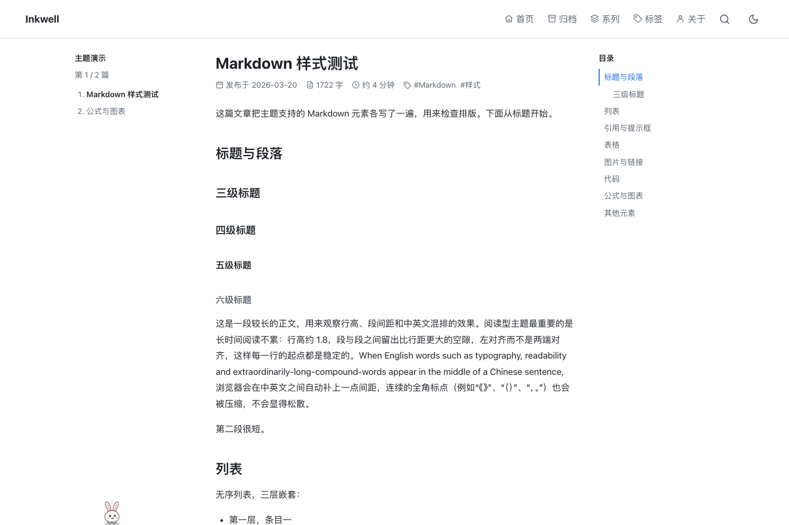
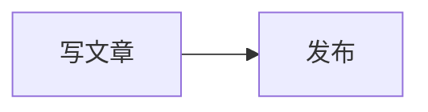

# Inkwell

[English](https://github.com/boreasward/Inkwell/blob/main/README.md) | 简体中文

Inkwell 是一个以“读文章”为中心的 Hugo 主题：素白风格，窄屏（手机）和宽屏（桌面）都认真设计过阅读体验，中文长文、代码、图片、公式和图表都有成体系的样式，明暗两套配色。



主要特点：

- 文章页三档布局：宽屏正文右侧是跟随滚动高亮的目录，左侧是系列导航（中等宽度时系列收进底部抽屉）；窄屏用悬浮按钮和抽屉（目录、系列两个页签）。
- 中文排版调过：行高、段距、行宽、中英混排、标点压缩；超宽的代码、表格、图片、公式、长链接都在块内处理，不会撑出横向滚动条。
- 代码块（语法高亮、语言名、复制按钮、行号与行高亮）、提示框、图片图注与点击放大、数学公式、Mermaid 图表。
- 系列（基于 Hugo 分类法）、标签、归档、客户端搜索、深色模式（默认跟随系统，可手动切换）、giscus 评论（默认关闭）。
- 页面点缀：导航、日期、页脚等处的线条图标，以及左下角一只会蹦跳的小兔子（可关闭）。
- 只用 `hugo` 一个命令：没有 Node、没有打包器、不需要 Hugo extended，只用系统字体。第三方库只有 KaTeX 样式表、Mermaid、giscus 三个，全部按需从 CDN 加载，地址可配置。

## 要求

- Hugo **≥ 0.158.0**（主题使用 `locale` 配置与 `.Site.Language.Locale`）。不需要 extended 版本。
- 开发与验收所用版本：Hugo 0.169.0。

## 安装

在站点目录里把主题放进 `themes/Inkwell`，二选一：

```bash
# 方式一：git submodule
git submodule add https://github.com/boreasward/Inkwell.git themes/Inkwell

# 方式二：直接克隆
git clone https://github.com/boreasward/Inkwell.git themes/Inkwell
```

然后在站点配置里写 `theme = "Inkwell"`，并复制下一节的站点配置。

也可以用 Hugo Module 的方式引用（需要安装 Go）：在站点目录执行 `hugo mod init github.com/<你>/<你的站点>`，再把 `theme = "Inkwell"` 换成：

```toml
[module]
  [[module.imports]]
    path = "github.com/boreasward/Inkwell"
```

## 必须复制的站点配置

Hugo 只会合并主题配置里的 `params`、菜单、输出格式和媒体类型，**不会**合并 `taxonomies`、`markup`、语言等设置，所以下面这段只能由站点自己声明。把它整段复制进你的 `hugo.toml`：

```toml
locale = "zh-CN"
defaultContentLanguage = "zh-cn"
hasCJKLanguage = true
theme = "Inkwell"

[pagination]
  pagerSize = 20

[taxonomies]
  tag = "tags"
  series = "series"

[markup.tableOfContents]
  startLevel = 2
  endLevel = 3
[markup.goldmark.extensions.passthrough]
  enable = true
  [markup.goldmark.extensions.passthrough.delimiters]
    block = [['\[', '\]'], ['$$', '$$']]
    inline = [['\(', '\)']]
[markup.goldmark.parser]
  wrapStandAloneImageWithinParagraph = false
[markup.goldmark.renderer]
  unsafe = true
```

缺少配置时 Hugo **不会报错**，对应功能只是安静地消失。逐项说明如下：

| 配置项 | 作用 | 缺了会怎样 |
|---|---|---|
| `locale = "zh-CN"` | 输出到 `<html lang>`，并决定 giscus 评论框的界面语言 | `<html lang>` 取内容语言的名字（例如 `zh-cn`，没有设置 `defaultContentLanguage` 时是 `en`），不是标准的 `zh-CN`；giscus 评论框语言也按这个名字匹配，通常仍能得到中文 |
| `defaultContentLanguage = "zh-cn"` | 选择界面文字语言（主题自带 `zh-cn` 与 `en` 两套） | 目录、上一篇/下一篇、搜索、提示框类型名等界面文字变成英文 |
| `hasCJKLanguage = true` | 按汉字个数统计中文字数 | 字数、预计阅读时间和自动摘要严重偏小（一整段中文只算一个“词”） |
| `theme = "Inkwell"` | 启用主题；值必须与 `themes/` 下的目录名一致 | 站点没有任何模板 |
| `[pagination] pagerSize` | 首页文章列表每页篇数 | 使用 Hugo 默认的 10 篇（示例站点为了演示分页用了 5，实际站点建议 20） |
| `[taxonomies]` 里的 `series` | 声明“系列”分类法 | 系列相关功能全部不出现：系列页、文章页里的系列页签与序号、系列内的上一篇/下一篇、系列总览；`series` 字段被当作普通 front matter。同时需要保留 `tag = "tags"`，否则标签也会消失 |
| `[markup.tableOfContents]` | 目录收录的标题层级（二到三级） | 取 Hugo 默认值，恰好也是 2 到 3 级；写出来是为了明确层级，改动它会同步改变目录 |
| `passthrough` 与 `delimiters` | 让 `\( \)`、`\[ \]`、`$$ $$` 被识别为公式 | 公式保持 LaTeX 原文，不会被排版，也不会加载 KaTeX 样式表 |
| `wrapStandAloneImageWithinParagraph = false` | 独占一段的图片输出为 `<figure>` | 图片退化为行内 ``，没有图注（`title` 只作为鼠标悬停提示），也不会带 figure 样式 |
| `[markup.goldmark.renderer] unsafe = true`（可选） | 允许正文里直接写 `<kbd>`、`<mark>`、`<details>` | 这些原始 HTML 被丢弃（输出 `<!-- raw HTML omitted -->`），构建时 Hugo 还会给出警告；不用这些标签就不需要它 |

示例站点（`exampleSite/hugo.toml`）在此基础上另有 `themesDir = "../.."`、`[params.search] enable = true` 和 `menus.main`。导航菜单用 Hugo 标准的 `menus.main`：

```toml
[[menus.main]]
  name = "归档"
  pageRef = "/archives"
  weight = 20
```

归档页需要自己建一个内容文件 `content/archives.md`，内容是 front matter `layout = "archives"`（可再写 `title = "归档"`）。系列总览在 `/series/`，标签总览在 `/tags/`，由 Hugo 自动生成。

## 主题配置（params）

下面是主题 `hugo.toml` 里的全部 `params`，默认值如下；在站点配置里写同名键即可覆盖。

```toml
[params.home]
  listStyle = "compact"
[params.article]
  showWordCount = true
  showReadingTime = true
  externalLinkNewTab = true
[params.search]
  enable = false
[params.math]
  enable = true
  css = "https://cdn.jsdelivr.net/npm/katex@0.18.4/dist/katex.min.css"
  cssIntegrity = "sha384-u1zONI5gPXUx0UKI62c75/zww972y0v2rSK5ZYlVdS6xEuWDeZWUI66v6t1gvlXJ"
[params.mermaid]
  url = "https://cdn.jsdelivr.net/npm/mermaid@11/dist/mermaid.esm.min.mjs"
[params.header]
  navIcons = true
[params.footer]
  text = ""
  links = []
[params.pet]
  enable = true
[params.comments.giscus]
  repo = ""
  repoId = ""
  category = ""
  categoryId = ""
  mapping = "pathname"
```

| 键 | 默认值 | 说明 |
|---|---|---|
| `home.listStyle` | `"compact"` | 首页列表样式。`"compact"`：按年份分组，每篇一行（日期 + 标题）；`"summary"`：标题、日期、标签加两三行摘要。两种都分页 |
| `article.showWordCount` | `true` | 文章头部是否显示字数 |
| `article.showReadingTime` | `true` | 文章头部是否显示预计阅读时间 |
| `article.externalLinkNewTab` | `true` | 正文里的外部链接是否在新窗口打开（带 `rel="noopener"`）；站内链接始终在当前窗口 |
| `search.enable` | `false` | 搜索开关。开启后页头出现搜索入口，点击或按 <kbd>/</kbd> 打开搜索弹窗；构建时在站点根输出 `search-index.json`，首次打开弹窗才下载 |
| `math.enable` | `true` | 公式开关。关闭后公式按纯文本输出（块级写成 `$$…$$`、行内写成 `\(…\)`，用 `\[…\]` 写的块级公式也会变成 `$$…$$`），不排版也不加载样式。公式需要配合上一节的 `passthrough` 配置 |
| `math.css` | KaTeX 0.18.4 的 CDN 地址 | KaTeX 样式表地址，只在用到公式的页面加载。可换成自己托管的地址；设为空字符串则不加载（公式会缺少样式） |
| `math.cssIntegrity` | 与默认地址匹配的 SRI 哈希 | 样式表的 `integrity` 值。**改了 `math.css` 就必须同步改这个值**，不需要时设为空字符串 |
| `mermaid.url` | Mermaid 11 的 CDN 地址（ESM） | Mermaid 脚本地址，只在含 ` ```mermaid ` 代码块的页面加载 |
| `footer.text` | `""` | 页脚的一行自定义文字，空则不显示；按行内 Markdown 渲染（站点配置是可信的），所以可以放链接，例如 ICP 备案：`text = "[京ICP备12345678号](https://beian.miit.gov.cn/)"`。页脚始终有版权行和 RSS 链接 |
| `header.navIcons` | `true` | 导航菜单项前是否显示图标。窄屏（< 600px）下导航始终只显示文字 |
| `footer.links` | `[]` | 页脚链接，和版权、RSS 同一行显示、各带一个图标。每项是 `{ name, url, icon }`；`icon` 省略时按地址推断（`github.com` → GitHub 图标，`mailto:` → 信封，其余 → 地球），写 `"none"` 不显示图标。示例见下文 |
| `pet.enable` | `true` | 页面左下角随机蹦跳的小兔子：会在页面底部蹦来蹦去、眨眼、眼睛跟着鼠标，点它会跳起来并冒出爱心。纯装饰，对读屏隐藏，打印时不显示；系统开启“减弱动态效果”时只待在原地。不想要就设为 `false` |
| `comments.giscus.repo` | `""` | giscus 的仓库，形如 `owner/repo`。**非空即开启评论**，为空则整个评论功能不输出任何内容 |
| `comments.giscus.repoId` | `""` | giscus 仓库 ID |
| `comments.giscus.category` | `""` | giscus 讨论分类名 |
| `comments.giscus.categoryId` | `""` | giscus 讨论分类 ID |
| `comments.giscus.mapping` | `"pathname"` | 文章与讨论的对应方式，直接传给 giscus |

导航图标默认按菜单指向的页面自动选择：首页、归档（`layout = "archives"`）、系列总览、标签总览、`/about` 各有对应图标，其他菜单项没有图标。可以在菜单项上用 `params.icon` 指定或关闭（写 `"none"`），图标名见 `layouts/_partials/icon.html`：

```toml
[[menus.main]]
  name = "友链"
  pageRef = "/links"
  weight = 60
  [menus.main.params]
    icon = "globe"
```

页脚链接示例（原来写在 `footer.text` 里的 GitHub 链接可以挪到这里，就会带上图标）：

```toml
[[params.footer.links]]
  name = "GitHub"
  url = "https://github.com/owner"
[[params.footer.links]]
  name = "邮箱"
  url = "mailto:me@example.com"
```

评论的四个参数（仓库、仓库 ID、分类、分类 ID）可在 [giscus.app](https://giscus.app/) 上生成。评论区在滚动到附近时才加载，并随明暗模式切换。占位示例：

```toml
[params.comments.giscus]
  repo = "owner/repo"
  repoId = "R_xxxxxxxx"
  category = "General"
  categoryId = "DIC_xxxxxxxx"
```

界面语言只有简体中文和英文两套（`i18n/zh-cn.toml`、`i18n/en.toml`）。想改某句文案，在站点的 `i18n/` 下放同名文件覆盖对应的键即可。

## front matter 字段

文章 front matter 可用的字段：

| 字段 | 示例 | 说明 |
|---|---|---|
| `title` | `"长篇随笔"` | 标题。特殊字符（引号、尖括号、`&`）会被正确转义 |
| `date` | `2026-02-18T08:30:00+08:00` | 发布日期，页面上显示为 ISO 格式 `YYYY-MM-DD`（例如 `2026-02-18`）；列表按它排序，有 `lastmod` 且与发布日期不同日时另显示更新日期 |
| `description` | `"一句话摘要"` | 摘要。用作 `<meta name="description">`，摘要样式的首页列表和搜索结果也用它；不写则取正文开头 |
| `tags` | `["随笔", "Hugo"]` | 标签 |
| `series` | `["Hugo 入门"]` | 所属系列，需要先声明 `series` 分类法。一篇文章只按它的第一个系列展示 |
| `weight` | `1` | 系列内的排序：系列里只要有一篇设置了 `weight`，整个系列就按 `weight` 升序；都没有设置则按日期升序 |
| `toc` | `false` | 设为 `false` 不显示目录和窄屏的悬浮按钮。文章里的标题少于 2 个时也不显示目录 |
| `comments` | `false` | 设为 `false` 关闭这一篇的评论（评论本身需要先配置 giscus） |

系列的简介来自 `content/series/<系列名>/_index.md`（可选，目录名用系列名本身，例如 `content/series/hugo-入门/_index.md`；正文就是简介）。

`archetypes/default.md` 是新文章的原型，`hugo new content posts/xxx.md` 会用它。

## Markdown 写法示例

**提示框**：用 GitHub 风格语法，支持 `NOTE`、`TIP`、`IMPORTANT`、`WARNING`、`CAUTION`，类型名显示为界面语言对应的文字；在类型后面写一段文字可以自定义标题：

```markdown
> [!NOTE]
> 补充背景信息。

> [!TIP] 自定义标题
> 写了自定义标题就不显示默认的类型名。
```

**数学公式**：行内用 `\( … \)`，块级用 `$$ … $$` 或 `\[ … \]`。公式在构建时由 Hugo 内置的 KaTeX 排好版，页面只加载一份样式表：

```markdown
质能方程 \(E = mc^2\) 写在句子中间。

$$
\int_{-\infty}^{+\infty} e^{-x^2}\,dx = \sqrt{\pi}
$$
```

**Mermaid 图表**：用 ` ```mermaid ` 代码块，图表在浏览器里渲染，配色跟随明暗模式：

````markdown

````

**图片与图注**：独占一段的图片，`title` 就是图注；没有 `title` 则不显示图注。行内图片（和文字写在同一段里）的 `title` 只会变成鼠标悬停提示，不显示图注。图片点击可放大，点击图片或按 <kbd>Esc</kbd> 关闭（包在链接里的图片不会放大，照常跳转），并且是懒加载的：

```markdown

```

**代码块**：带语言的代码块顶部显示语言名和复制按钮；行号和行高亮用 Hugo 标准的属性写法：

````markdown
```js {linenos=true, hl_lines=[2]}
const a = 1;
const b = 2;
```
````

另外还支持表格（宽表格在自己的容器里横向滚动）、任务列表、脚注、定义列表、`<kbd>`、`<mark>`、`<details>`（后三者需要 `unsafe = true`）。完整样例见示例站点里的《Markdown 样式测试》。

## 用 CSS 变量覆盖样式

所有颜色、字号、间距都集中在 `assets/css/tokens.css` 里的 CSS 变量，样式表里不再写死这些数值。有两种覆盖办法：

- **只改需要的变量（推荐）**：在你站点里新建 `assets/css/custom.css`，主题会把它排在所有主题样式之后载入，只写要改的变量即可（文件不存在就跳过）。深色值写在 `:root[data-theme="dark"]` 里，例如：

  ```css
  :root { --c-accent: #0a7d5a; --measure: 38em; }
  :root[data-theme="dark"] { --c-accent: #3ddc97; }
  ```

- **整个文件替换**：Hugo 的资源查找规则是“站点优先于主题”，把主题里的 `assets/css/tokens.css` 复制到你站点的 `assets/css/tokens.css`（同一路径）再改。注意深色模式那一块（`:root[data-theme="dark"]`）也要保留并同步修改；主题以后新增的变量不会自动出现在你的副本里。

主要变量如下（浅色在 `:root`，深色在 `:root[data-theme="dark"]` 里覆盖同名变量）：

| 变量 | 浅色 | 深色 | 用途 |
|---|---|---|---|
| `--c-bg` | `#ffffff` | `#0d1117` | 页面背景 |
| `--c-bg-subtle` | `#f6f8fa` | `#151b23` | 次级背景（抽屉、表头等） |
| `--c-text` | `#1f2328` | `#d1d7e0` | 正文文字 |
| `--c-text-muted` | `#59636e` | `#8b949e` | 次要文字（日期、引用块） |
| `--c-border` | `#d1d9e0` | `#30363d` | 分隔线与边框 |
| `--c-accent` | `#1f6feb` | `#58a6ff` | 链接与强调色 |
| `--c-code-bg` | `#f6f8fa` | `#161b22` | 代码背景 |
| `--c-mark` | `#fff8c5` | `rgba(187, 128, 9, 0.4)` | `<mark>` 高亮底色 |
| `--c-note` `--c-tip` `--c-important` `--c-warning` `--c-caution` | 见文件 | 见文件 | 五种提示框的颜色 |
| `--hl-*`（`comment`、`keyword`、`string`、`number`、`func`、`type`、`tag`、`attr`、`line`） | 见文件 | 见文件 | 代码高亮配色 |

只有一套（不分明暗）的尺寸变量：

| 变量 | 默认值 | 用途 |
|---|---|---|
| `--measure` | `40em` | 正文行宽 |
| `--sidebar` | `220px` | 宽屏两侧栏（系列导航与目录）的宽度 |
| `--gap` | `48px` | 目录栏与正文的间距 |
| `--font-sans` / `--font-mono` | 系统字体栈 | 正文字体 / 代码字体 |
| `--fs-base` | `16px`（宽度 ≥ 1000px 时 `17px`） | 正文字号 |
| `--lh-base` | `1.8` | 正文行高 |
| `--fs-sm` `--fs-body` `--fs-md` `--fs-lg` `--fs-title` 等 | 见文件 | 字号刻度（小字、正文、页头标题、列表标题、页面与文章标题） |
| `--radius` | `6px` | 圆角 |

深色只在 `data-theme="dark"` 下生效，由页面最早期的内联脚本决定（读取本地保存的选择，没有则跟随系统），因此不会先闪一下白色。没有手动选择过时，系统明暗在页面打开期间切换也会实时跟随；手动切换后以保存的选择为准。

## 本地运行示例站点

`exampleSite/` 是可以直接运行的示例，同时是主题的验收样本。它通过 `themesDir = "../.."` 引用上级目录里的主题，所以**仓库目录名必须是 `Inkwell`**（与 `theme = "Inkwell"` 对应）：

```bash
git clone https://github.com/boreasward/Inkwell.git Inkwell
cd Inkwell
hugo server --source exampleSite
```

想看摘要样式的首页，可以用环境变量临时覆盖：

```bash
HUGO_PARAMS_HOME_LISTSTYLE=summary hugo server --source exampleSite
```

## 运行测试

```bash
bash tests/run.sh
```

脚本会分别构建默认、最小配置、子路径（`baseURL = https://example.org/blog/`）、摘要样式和评论五种配置，对产物做断言（构建输出出现 `WARN` 或 `ERROR` 即失败），最后运行 `node --test`，所以需要安装 Node（仅测试用，使用主题本身不需要）。全部通过时最后一行输出 `== 全部通过 ==`。

## 已知限制

- **搜索是关键词包含匹配**：不区分大小写，按空格拆成多个关键词、全部命中才算匹配，标题命中排在前面；没有分词、模糊匹配和相关度排序。索引是一个 JSON 文件，文章上千篇时体积会偏大。
- **关闭 JavaScript 时固定为浅色**：深色模式、搜索、代码复制、图片放大、目录抽屉和评论都需要 JavaScript；文章正文、导航和（排在正文前的）目录仍然可用。
- **KaTeX 样式表版本可能与 Hugo 内置的 KaTeX 不一致**：公式由 Hugo 内置的 KaTeX 在构建时排版，样式表则取自 `math.css`（默认 0.18.4）。较旧的 Hugo 内置的 KaTeX 版本可能更低，两者差异大时个别公式的排版会有细微偏差；需要时把 `math.css` 与 `math.cssIntegrity` 改成与你的 Hugo 对应的版本。
- **评论没有做过真实的端到端验证**：目前没有可用于 giscus 的真实仓库，只验证了“脚本按需注入、切换明暗时向评论框发出消息”。填入你自己的仓库参数后如有问题，欢迎反馈。
- 界面文字只有简体中文和英文两套，不提供语言切换界面；日期统一显示为 `YYYY-MM-DD`，不做本地化。

## 许可

[MIT](https://github.com/boreasward/Inkwell/blob/main/LICENSE)
