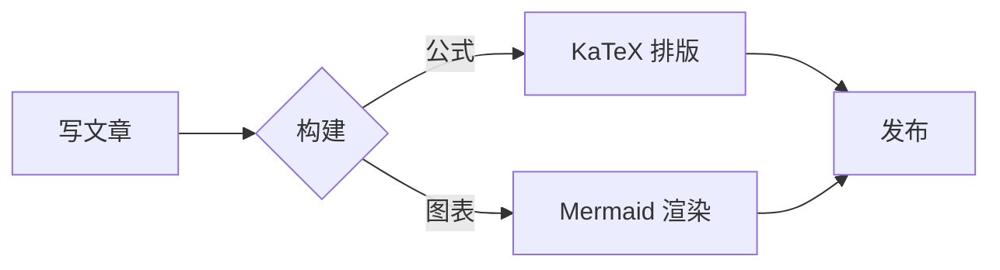
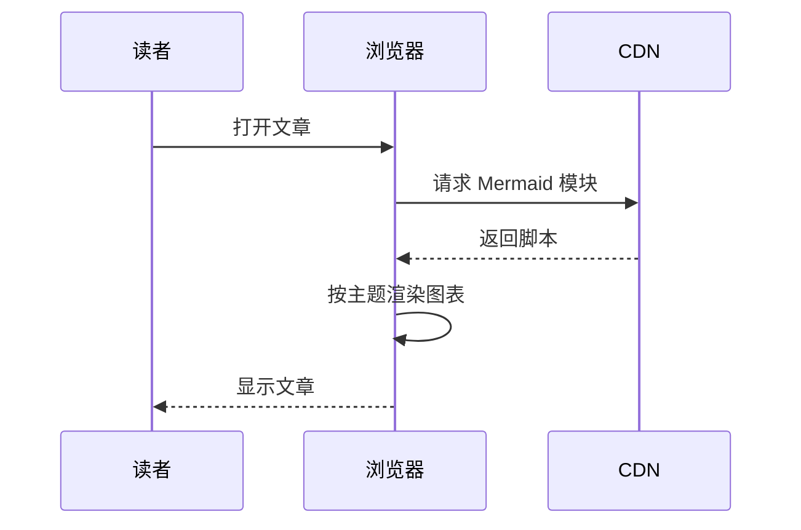

+++
title = "公式与图表"
date = 2026-04-10T10:00:00+08:00
description = "数学公式与 Mermaid 图表的渲染演示。"
series = ["主题演示"]
tags = ["数学", "Mermaid"]
+++

本篇演示构建期渲染的数学公式，以及按需加载的 Mermaid 图表。公式在 Hugo 构建时由 KaTeX 排好版，浏览器只需要一份样式表；图表则在页面里由 Mermaid 渲染，并跟随明暗主题换色。

## 行内公式

质能方程 \(E = mc^2\) 是物理学里最著名的公式，圆的面积是 \(S = \pi r^2\)，一元二次方程 \(ax^2 + bx + c = 0\) 的根是 \(x = \frac{-b \pm \sqrt{b^2 - 4ac}}{2a}\)。行内公式应该和周围的中文基线对齐，不撑大行距。

## 块级公式

高斯积分：

$$
\int_{-\infty}^{+\infty} e^{-x^2}\,dx = \sqrt{\pi}
$$

欧拉恒等式把五个最基本的常数放在了一起：

$$
e^{i\pi} + 1 = 0
$$

下面是一条很长的块级公式。在窄屏幕上它会在自己的框里横向滚动，而不是把整个页面撑出滚动条：

$$
S_n = a_1 + a_2 + a_3 + a_4 + a_5 + a_6 + a_7 + a_8 + a_9 + a_{10} + a_{11} + a_{12} + a_{13} + a_{14} + a_{15} + a_{16} + a_{17} + a_{18} + a_{19} + a_{20} = \sum_{k=1}^{20} a_k
$$

## 流程图

## 时序图

