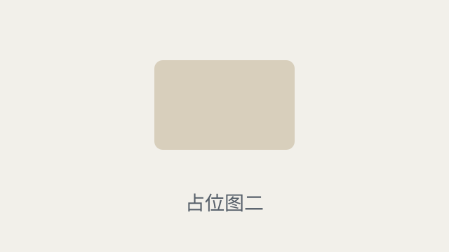

+++
title = "图文笔记"
date = 2026-01-25T14:00:00+08:00
description = "页面包（page bundle）与图片渲染演示。"
tags = ["图文"]
+++

这是一篇图文笔记，同一个目录下放了三张占位图片。点击任意一张图片可以放大，点击图片或按 Esc 关闭。

图片的 `title` 会作为图注显示在图片下方。没有 `title` 的图片不显示图注：

最后一张同样带图注：

